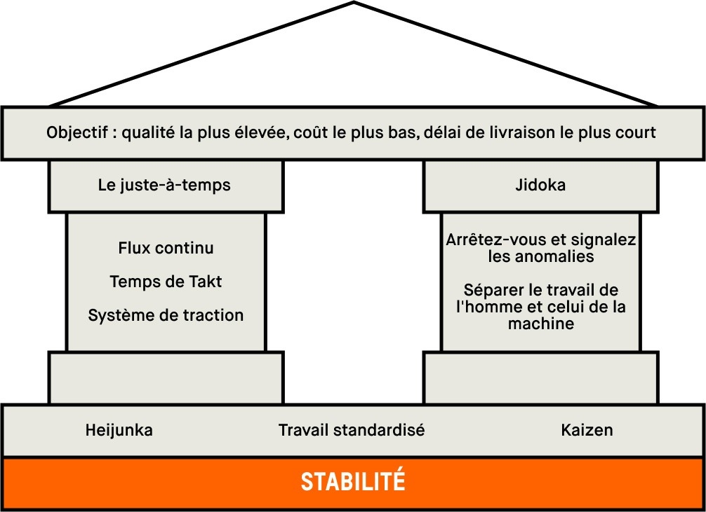

# 🏭 Le défi Toyota : construisez votre usine logicielle

> **Chez Toyota, la qualité n'est pas contrôlée en bout de chaîne. Elle est construite, à chaque instant, par celles et ceux qui produisent.**
>
> Cette nuit, quel que soit le thème imposé, votre produit ne sera pas jugé seulement sur ce qu'il fait — mais sur **la façon dont vous l'avez fabriqué**.

---

## 🎯 Votre mission

Vous n'allez pas seulement développer une application. Vous allez construire une **usine logicielle** inspirée du Toyota Production System (TPS) :

- **Jidoka** — dès qu'un défaut apparaît, la ligne s'arrête : votre chaîne CI détecte et bloque la dégradation.
- **Kaizen** — amélioration continue : votre score ne vaut pas par sa valeur finale, mais par sa trajectoire.
- **Heijunka** — lissage : un rythme de production régulier vaut mieux qu'un rush de dernière minute.
- **Poka-yoke** — anti-erreur : des garde-fous qui empêchent le défaut d'entrer dans la chaîne.

    

**Le produit qui gagne n'est pas celui qui fait le plus de fonctionnalités. C'est celui qui sort de la ligne avec la meilleure qualité, livré par l'usine la plus respectueuse de ses standards.**

---

## 📋 Comment participer

1. Créez un **repository GitHub public** pour votre projet d'équipe.
2. Ajoutez le fichier d'appel du workflow Toyota **sans le modifier** (template fourni, 3 lignes, `uses: Haingue/nuitdelinfo2026/.github/workflows/quality.yml@v1`).
3. Ouvrez une **issue d'inscription** sur notre repo du défi avec le template prévu (nom d'équipe + URL du repo).
4. À chaque push sur `main`, notre usine mesure automatiquement votre qualité : SonarCloud (gate, maintenabilité, sécurité, couverture) + audit des dépendances.
5. Suivez le **leaderboard en direct** (mis à jour toutes les 15 minutes) sur la page du défi.

---

## 🏆 Les critères d'évaluation (100 points + bonus/malus)

### A. Qualité à la livraison — 60 pts

| Critère                                                      | Points |
| ------------------------------------------------------------ | ------ |
| Quality Gate SonarCloud **vert** sur le dernier scan         | 20     |
| Note de maintenabilité (A = 15, B = 10, C = 5, D/E = 0)      | 15     |
| Note de sécurité (A = 10, B = 6, C = 3, D/E = 0)             | 10     |
| Couverture de tests (≥ 60 % = 10 pts, sinon proportionnelle) | 10     |
| Zéro vulnérabilité critique ou haute dans les dépendances    | 5      |

### B. Kaizen — votre trajectoire — 40 pts

| Critère                                                                             | Points |
| ----------------------------------------------------------------------------------- | ------ |
| **Pente de progression** : écart entre votre premier et votre dernier score qualité | 20     |
| **Résilience (Jidoka)** : chaque Quality Gate rouge redressé au vert compte         | 10     |
| **Heijunka** : régularité de vos commits au fil de la nuit (pas de rush final)      | 10     |

### C. Bonus & malus

|                                                           | Points  |
| --------------------------------------------------------- | ------- |
| 🟢 Jamais laissé un Quality Gate rouge plus de 30 minutes | **+5**  |
| 🟢 Régression corrigée dans le commit suivant             | **+3**  |
| 🔴 Dernier scan en régression par rapport au précédent    | **−5**  |
| 🔴 Quality Gate rouge à la fin de la nuit                 | **−10** |

---

## ⚠️ Contraintes d'éligibilité

Votre projet est évalué uniquement si **toutes** ces conditions sont respectées :

1. **Repo public** sur GitHub, accessible dès votre inscription jusqu'à la clôture.
2. **Workflow d'appel strictement conforme** au template fourni : toute modification, exclusion de fichiers ou contournement du scan entraîne la disqualification. Le paramétrage du scan (exclusions, seuils) est contrôlé par notre workflow — pas par vous.
3. **Branche `main` protégée** : le merge est bloqué si le Quality Gate est rouge.
4. **Minimum de 20 commits** sur la nuit, pour que votre trajectoire Kaizen ait un sens.
5. **Scan sur l'intégralité du code** du repository : les paramètres d'exclusion du projet SonarCloud sont vérifiés via l'API.
6. **Token SonarCloud propre à l'équipe** : chaque équipe crée son compte SonarCloud, déclare son organisation et génère un token d'analyse (voir procédure ci-dessous).
7. **Empreinte d'identité** : votre fichier d'appel contient l'empreinte d'identité générée à votre inscription ; elle lie votre équipe à votre repository. Une empreinte qui ne correspond pas au repo scanné entraîne la disqualification.
8. Un **seuil de score minimum** (fixé par Toyota après analyse des résultats) conditionne le classement final.

💡 **Astuce** : commencez dès le premier commit par des garde-fous stricts (lint, tests, gate). Un projet modulaire, testé et propre dès le départ a une trajectoire plus lisible qu'un projet corrigé dans la dernière heure.

---

## 🔑 Procédure — Token SonarCloud (obligatoire)

Votre workflow d'appel lance un scan SonarCloud à chaque push. Celui-ci s'authentifie avec **votre** token :

1. Créez un compte sur [sonarcloud.io](https://sonarcloud.io) avec votre compte GitHub.
2. ⚠️ **Une seule personne par équipe fait ceci : le PROPRIÉTAIRE du repository** (celui ou celle qui l'a créé). Dans SonarCloud, choisissez **« Import repository from GitHub »** et sélectionnez votre repo : cela crée votre organisation SonarCloud dont la clé = votre login GitHub. **Ne créez pas une organisation manuellement avec un nom personnalisé** — le workflow Toyota déduit automatiquement votre organisation à partir du propriétaire du repo ; un autre nom casserait le scan.
3. Générez un token : *Mon compte → Sécurité → Generate token* (droits : *Analyze projects*).
4. Ajoutez-le comme secret dans votre repo GitHub : *Settings → Secrets and variables → Actions → New repository secret*, nommé **`SONAR_TOKEN`**. Ne le partagez jamais, ne le committez jamais.

> 💡 Vous n'avez **rien d'autre à configurer** : la clé de projet, l'organisation SonarCloud et les exclusions de scan sont déduites automatiquement par le workflow Toyota. Votre token ne sert qu'à authentifier le scan de **votre** repository.
>
> 👥 **Travail en équipe** : les autres membres ne créent ni repo ni organisation SonarCloud — ils sont ajoutés en **collaborateurs** du repo GitHub (*Settings → Collaborators*) et poussent normalement. Le scoring analyse le repo et les commits de **toute** l'équipe.

---

## 🤝 L'esprit du défi

Ce défi ne récompense pas la vitesse brute ni le volume de code. Il récompense la **discipline de production** : détecter tôt, corriger vite, ne jamais laisser la ligne se dégrader, progresser à chaque itération.

Ce sont exactement les principes que nous appliquons chaque jour chez Toyota. Cette nuit, c'est votre tour.

**Bonne nuit. Bonne production. 頑張って !**
